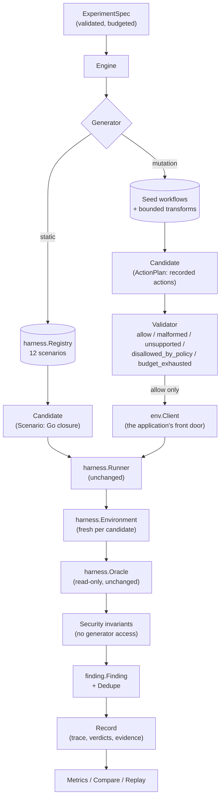

# Research Architecture

BankSec Lab began as a simulated banking system with a fixed corpus of
twelve attack scenarios. This document describes the architecture added
on top of that corpus so the project can be used as a reproducible
research platform: one that can ask whether *adaptive* attack generation
discovers independently verified security violations that fixed
scenarios miss, while keeping reproducibility, execution safety, and
measurable cost.

The banking simulator itself is unchanged. Nothing in `internal/ledger`,
`internal/backend`, `internal/protocol`, `internal/crypto`,
`internal/keystore`, `internal/audit`, or `internal/detection` was
modified; neither was `internal/harness`. The research architecture is
two new packages that sit above them.

## 1. What existed before

| Concern | Where | State |
| --- | --- | --- |
| Banking operations, double-entry ledger, authorization | `internal/backend`, `internal/ledger` | Complete |
| Wire protocol with auth tags, replay/downgrade checks | `internal/protocol` | Complete |
| Three cryptographic profiles (weak-educational, standard, PQC) | `internal/crypto` | Complete |
| Key lifecycle: generation, rotation, revocation | `internal/keystore` | Complete |
| Hash-chained audit log, detection rules | `internal/audit`, `internal/detection` | Complete |
| Twelve attack scenarios, read-only oracle, runner | `internal/harness` | Complete |
| Comparative benchmarking, JSON/CSV export | `internal/benchmark` | Complete |

Four concerns were **absent**, and they are exactly the ones a research
platform needs:

1. No typed, validated **experiment specification**. An attack ran with a
   seed and a timeout; there was no budget, no stop condition, no
   recorded configuration.
2. No **generator abstraction**. The twelve scenarios were the only thing
   that could produce a test.
3. No **validation boundary**. A scenario reached the simulator directly,
   which is safe for twelve reviewed scenarios and unsafe as a
   foundation for anything generated.
4. No **finding taxonomy**. `harness.Result.Success` was a boolean; there
   was no way to distinguish an attack the system prevented from a
   verified violation from an experiment that simply failed.

## 2. What was added

Two packages, neither of which anything existing imports:

- **`internal/finding`** — the outcome taxonomy, the `Finding` record, and
  conservative deduplication. Depends on nothing else in the project, so
  classification rules are testable apart from whatever executed the
  attack.
- **`internal/experiment`** — the experiment specification, the generator
  contract, the canonical action contract, the validation boundary, the
  security invariants, the engine, the experiment record, and the
  comparative metrics.

## 3. Data flow



Both candidate kinds reach the same runner, the same oracle, the same
`harness.Result`, and the same invariants applied to the same before/after
snapshots. The asymmetry is only at the front: a plan's every action
passes through the validator and lands in the step trace, whereas a
baseline scenario's internal actions do not.

### Why baseline scenarios are not plans

Three of the twelve registered scenarios use `harness.PrivilegedAccess` —
an insider-style channel that writes to the ledger, audit log, or
keystore beneath the application entirely (`ledger-tamper`,
`audit-tamper`, `key-exposure`). No sequence of banking operations can
express that, so rewriting them as action plans would silently delete the
attacks they implement. They stay as Go closures, and `Candidate` carries
either a plan or a scenario. The consequence is honest and visible:
trace-dependent invariants report `inconclusive` for baseline candidates
rather than guessing from evidence they do not have.

## 4. The validation boundary

`experiment.Validator` sits between every generator and the simulator.
It returns one of five decisions, and keeping them apart is the point —
collapsing them would make "the generator produced nonsense" and "the
banking system refused a legitimate attack" look identical, and only the
second is a result.

| Decision | Meaning |
| --- | --- |
| `allow` | Well-formed, permitted, within budget. Submitted to the simulator, which may still refuse it. |
| `malformed` | Cannot become a request: missing parameter, unparseable amount, empty actor, unknown role. |
| `unsupported` | Not an operation the simulator dispatches. |
| `disallowed_by_policy` | Well-formed, but this experiment's safety settings exclude it. |
| `budget_exhausted` | The action budget is spent. |

What it enforces is **safety, policy, and budget — not correctness**. It
deliberately does not reproduce the banking application's own input
validation. A negative amount, a zero amount, or a withdrawal by someone
else's actor are all well-formed proposals that reach the simulator,
because whether the simulator refuses them is the thing under test.
Pre-rejecting them would do the system-under-test's job on its behalf and
hide exactly the weaknesses an experiment exists to find.

A generated action can reach the simulator only through
`planScenario`'s `Exec`, which calls the validator per action and sends
nothing that did not come back `allow`. Generators receive no database
handle, no key material, no filesystem or network access, and no
privileged channel. The strongest thing a generator can cause is a
request a hostile client could already have sent.

## 5. Independent verification

`harness.Oracle` was already read-only and independent of attack
execution, and `harness.Runner` already discarded `Exec`'s return value
entirely — only what `Verify` observes through the oracle counts. The
research architecture adds **named invariants** on top of that, rather
than new access.

| Invariant | Severity | What it decides |
| --- | --- | --- |
| `ledger.double-entry` | critical | Every transaction's entries sum to zero. |
| `authz.no-unauthorized-value-extraction` | critical | No actor withdrew or transferred value out of an account they do not own. |
| `ledger.rejected-operation-no-effect` | high | An operation the system refused left the ledger unchanged. |

Each returns `confirmed_violation`, `blocked`, `inconclusive`, or
`error`. Three rules govern them:

- **A refusal is never a violation.** An unauthorized withdrawal the
  system rejected is `blocked`.
- **Attribution is required.** `ledger.rejected-operation-no-effect` can
  only conclude when *every* state-changing operation in the trace was
  refused; with a mix of accepted and refused operations a ledger change
  cannot be attributed, and the verdict is `inconclusive`.
- **Unknown ownership is inconclusive.** Ownership comes only from the
  trace's own successful `create-account` responses. An account whose
  owner the trace never established cannot be adjudicated either way.

### One result that is correct but easy to misread

`ledger.double-entry` reports a **confirmed violation under the hardened
profile** for the `ledger-tamper` scenario. That is correct: a privileged
insider write unbalances the ledger under every configuration, because it
writes beneath the application. What hardening adds is *detection*, which
this invariant does not measure. The scenario's own finding
(`scenario.ledger-tamper`) reports `blocked` under hardened and
`confirmed_violation` under vulnerable. **Both findings together are the
result**; either one alone misrepresents it. This is pinned by
`TestEngine_LedgerTamperUnbalancesTheLedgerEvenWhenDetected`.

## 6. Findings and deduplication

A finding's identity is `(invariant, component, target configuration,
outcome)`. Deliberately excluded: the attack ID, the generator, the seed,
and the action trace. Two generators tripping the same invariant on the
same component under the same configuration have found **one** weakness,
and counting it twice is how a finding count gets inflated.

Raw attempts and unique findings are kept as separate fields throughout
(`Set.RawAttempts` vs `Set.Unique`), and reports never present one as the
other.

Severity is **derived, not scored**: a confirmed violation carries the
violated invariant's own severity; every other outcome carries `info`.
There is no CVSS here. Assigning a CVSS vector needs evidence this
simulator does not produce, and an invented score is worse than none.

Evidence keys naming key material, credentials, or passphrases are
redacted before anything is written to a record, and the redaction is
listed so a reader can tell withheld data from absent data.

## 7. Metric definitions

Every ratio is a pointer, and a zero denominator yields *undefined*, not
zero. An experiment that found nothing has an undefined cost per finding;
reporting that as `0.0` would make the worst result look like the best.

| Metric | Numerator | Denominator | Undefined when |
| --- | --- | --- | --- |
| Unique confirmed findings | Deduplicated findings with outcome `confirmed_violation` | — (a count) | never |
| Finding yield per action | Unique confirmed findings | Actions submitted to the simulator | no action was submitted |
| Verification rate | `confirmed_violation` + `blocked` | All evaluated judgements | nothing was evaluated |
| Invariant coverage | Distinct invariants with a conclusive verdict | Distinct invariants evaluated | no invariant evaluated |
| Benign task success rate | Accepted state-changing operations by the account's own owner | All such operations submitted | none submitted |
| Cost per confirmed finding | Wall-clock ms | Unique confirmed findings | nothing confirmed |
| Reproducibility rate | Confirmed findings that reproduced on replay | Replayable confirmed findings | none replayable |

`Compare` checks that conditions actually are comparable — same target
configuration, same cryptographic profile, same action budget — and
records caveats when they are not. One caveat matters especially: **a
baseline run spends zero actions**, because its scenarios execute Go code
rather than submitting actions, so its finding yield is undefined.
Comparing a defined yield against an undefined one is not a comparison,
and `Compare` says so rather than letting a reader conclude that mutation
"wins on yield" when the baseline simply has no yield figure.

### Exact replay vs re-execution

`Engine.Replay` re-executes recorded action plans verbatim and reports
how many confirmed violations reproduce. Baseline scenarios can be
*re-executed* but not *replayed* action by action, because their
implementations are Go closures rather than recorded sequences. Replay
excludes them and says so in its note rather than counting them either
way.

## 8. Measured results

The figures below come from runs of this code. They are not projections.

Both generators, hardened and vulnerable profiles, equal budgets
(60 actions, 12 tests, seed 42):

| Profile | Generator | Tests | Actions | Unique confirmed | Blocked | Inconclusive | Coverage | Benign rate |
| --- | --- | --- | --- | --- | --- | --- | --- | --- |
| hardened | static | 12 | 0 | 1 | 12 | 35 | 0.33 | undefined |
| hardened | mutation | 11 | 50 | 0 | 14 | 19 | 0.67 | 0.83 |
| vulnerable | static | 12 | 0 | 9 | 4 | 35 | 0.33 | undefined |
| vulnerable | mutation | 11 | 50 | 1 | 12 | 19 | 0.67 | 0.83 |

The single hardened static finding is the `ledger.double-entry` result
described in §5. Mutation's one vulnerable finding is
`authz.no-unauthorized-value-extraction`, confirmed twice and reproduced
2/2 on replay (rate 1.0).

**The honest answer to the project's primary research question, as of
today: no.** With the two seed workflows and a 60-action budget,
mutation-based testing found *nothing the fixed corpus missed* — its one
unique finding is a subset of the baseline's nine. What it did
demonstrate is that the pipeline works end to end, that its findings are
independently verified and exactly reproducible, and that the same
property is confirmed under `vulnerable` and blocked under `hardened`.
Claiming more than that would not be supported by these numbers.

Two observations worth keeping:

- Mutation's **invariant coverage is twice the baseline's** (0.67 vs
  0.33), because it produces an action trace and the baseline does not.
  Coverage measures what the instrumentation reached, not how secure the
  system is.
- Mutation's **benign task success rate is 0.83 under both profiles** —
  legitimate banking work still works while attacks are being attempted.
  The baseline has no such figure.

## 9. Implemented, simulated, and planned

**Implemented and reachable through executable code:** experiment
specification and validation; static baseline generator over all twelve
registered scenarios; mutation generator with six bounded
transformations; canonical action contract; five-way validation
boundary with budget enforcement; three security invariants; finding
taxonomy with deduplication and redaction; per-candidate environment
isolation; structured experiment records with full action traces; seven
comparative metrics with documented definitions; exact replay for
plan-based findings.

**Simulated, and labelled as such:** the banking system itself, the
quantum simulator (`internal/quantum` is a classical state-vector
simulation, not quantum hardware), and the cryptographic profile
selection — choosing a profile is not a production cryptographic
deployment.

**Planned, and not claimed as working:** the adaptive generator. The
`Generator` interface is the extension point and is complete, but no
adaptive implementation exists. Conditions C and D of the evaluation
design (adaptive generator; adaptive generator with strict validation and
independent verification) are documented extension points, not results.

**Not present at all:** real HSM or KMS integration. There is no
reference to PKCS#11, any KMS, or any hardware security module anywhere
in the codebase. `internal/keystore` stores key material in SQLite,
optionally encrypted at rest. There is no abstraction separating key
*storage* from key *material*, so adding provider-backed custody later is
a genuine architectural change, not a wrapper. No claim of
hardware-backed key protection, production key custody, or regulatory
compliance is supported by this code.

## 10. Future LLM integration: the exact extension point

No LLM is integrated, no model is downloaded, and nothing in this
architecture calls a model. What follows is the plan, not a feature.

The extension point is `experiment.Generator`:

```go
type Generator interface {
    ID() string
    Next(ctx context.Context, obs Observation) (Candidate, error)
}
```

A local model-backed generator implements exactly this and requires **no
change** to the ledger, the backend, the protocol, the validator, or the
oracle. The safety controls that would contain it already exist and are
already enforced for the mutation generator:

1. It receives an `Observation` — the spec, budget counters, and
   summarized prior outcomes. No oracle, no environment, no key
   material, no database handle.
2. It returns a `Candidate` carrying an `ActionPlan`. It cannot return a
   `Scenario`, so it cannot reach `PrivilegedAccess`.
3. Every action it proposes passes `Validator.Validate`. An operation
   outside the six the simulator dispatches is `unsupported`; one outside
   the experiment's `allowed_ops` is `disallowed_by_policy`; an amount
   beyond `max_amount` is refused on magnitude, saturating at `MaxInt64`
   so boundary probing cannot wrap past the check.
4. Its action budget is enforced by the same counter, and only actions
   that actually reached the simulator are charged.
5. Its proposals are adjudicated by invariants it cannot see or
   influence. A generator asserting success proves nothing.
6. A generation error or timeout is recorded as an experiment error and
   never as an attack success (`TestEngine_GeneratorErrorIsNotAnAttackSuccess`).
7. Because a model is nondeterministic, a record produced by one would
   report `ExactReplaySupported` honestly and distinguish reproducing a
   *finding* from reproducing a *run*.

## 11. Limitations

- **Mutation seeds are authored, not extracted.** Registered scenarios are
  Go closures with no readable action sequence inside them, so
  `SeedPlans` reproduces the application-layer *workflow* those scenarios
  exercise rather than their actual steps. Mutations of those workflows
  are genuinely new action sequences, and each records what it changed —
  but they are not derived from the twelve scenarios' own code.
- **Mutation reaches only the application layer.** Six banking operations
  over a string-keyed parameter map is the whole action space. Protocol,
  cryptographic, and key-management attack surfaces are reachable only
  through the baseline corpus.
- **Baseline runs produce no action trace**, so three of the seven metrics
  are undefined for them and two of the three invariants report
  `inconclusive`.
- **The environment is isolated but not sandboxed.** Scenario `Exec` is
  ordinary in-process Go with this process's full privileges. That is
  acceptable for reviewed scenarios and would not be acceptable for an
  untrusted generator; containing one would need per-scenario OS-process
  sandboxing, which does not exist here.
- **Synthetic workload.** Accounts, amounts, and actors are fixtures.
  Nothing here establishes how a real banking system behaves under real
  traffic, real operational procedures, or real regulatory constraints.
- **Oracle independence is structural, not absolute.** The oracle reads
  the same SQLite stores the application writes. It does not share
  decision logic with attack generation, but it is not an independent
  reimplementation of double-entry accounting either.
- **No literature review has been done**, so no novelty is claimed.

## 12. Running an experiment

The `experiment` subcommand is the operator interface. It shares no flags,
no wiring, and no error paths with the banking commands — those still run
under `configs/hardened.json` exactly as before.

```bash
banksec experiment --list
```

Lists the registered scenarios, the mutation seed workflows, the
transformations, the invariants, and the operations a generated action
may propose. Runs nothing.

```bash
banksec experiment --tests 3
```

The default run: the static baseline against `hardened`, seed 42.

```bash
banksec experiment --compare --profile vulnerable --allow-privileged
```

Runs both generators at the same budget and prints the comparison with
its caveats.

```bash
banksec experiment --generator mutation --profile vulnerable \
  --tests 3 --actions 20 --out record.json
```

Writes the full machine-readable record — spec, action trace, validation
decisions, oracle snapshots, invariant verdicts, findings — to
`record.json`. With `--compare`, one record is written per condition,
suffixed by generator, so neither overwrites the other.

| Flag | Default | Purpose |
| --- | --- | --- |
| `--generator` | `static` | `static` or `mutation` |
| `--profile` | `hardened` | Security profile; anything other than hardened prints a warning |
| `--actions` | 60 | Action budget |
| `--tests` | 12 | Candidate budget |
| `--seed` | 42 | Random seed |
| `--scenarios` | all | Scenario IDs (static) or seed workflow IDs (mutation) |
| `--allow-privileged` | false | Admit scenarios using the insider bypass |
| `--stop-on-violation` | false | Halt at the first confirmed violation |
| `--out` | — | Write the full record to this path |
| `--list` | false | List the research surface and run nothing |
| `--compare` | false | Run both generators and compare |

Two deliberate behaviours worth knowing: an undefined ratio prints as
`undefined`, never as `0.0000`; and running against any profile other
than `hardened` prints a warning before any figure, because the banking
commands cannot reach a weakened configuration at all and an experiment
that can must not do so silently.

## 13. Reproducing the measurements

```bash
gofmt -l . && go vet ./... && go build ./... && go test -count=1 ./...
```

The figures in §8 come from the comparative runs in
`internal/experiment`. The differential result — the same property
confirmed under `vulnerable` and blocked under `hardened` — is asserted
by `TestEngine_AuthzBypassIsBlockedHardenedAndConfirmedVulnerable`.
